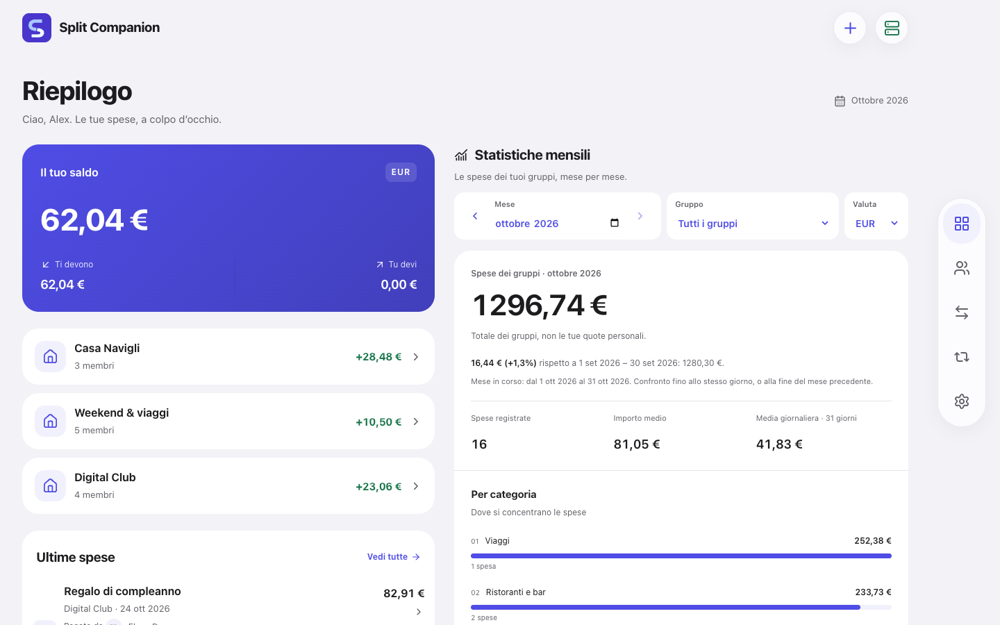
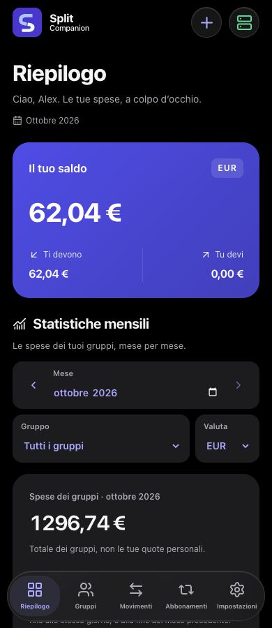
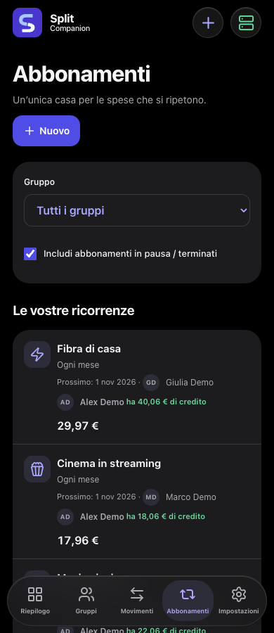
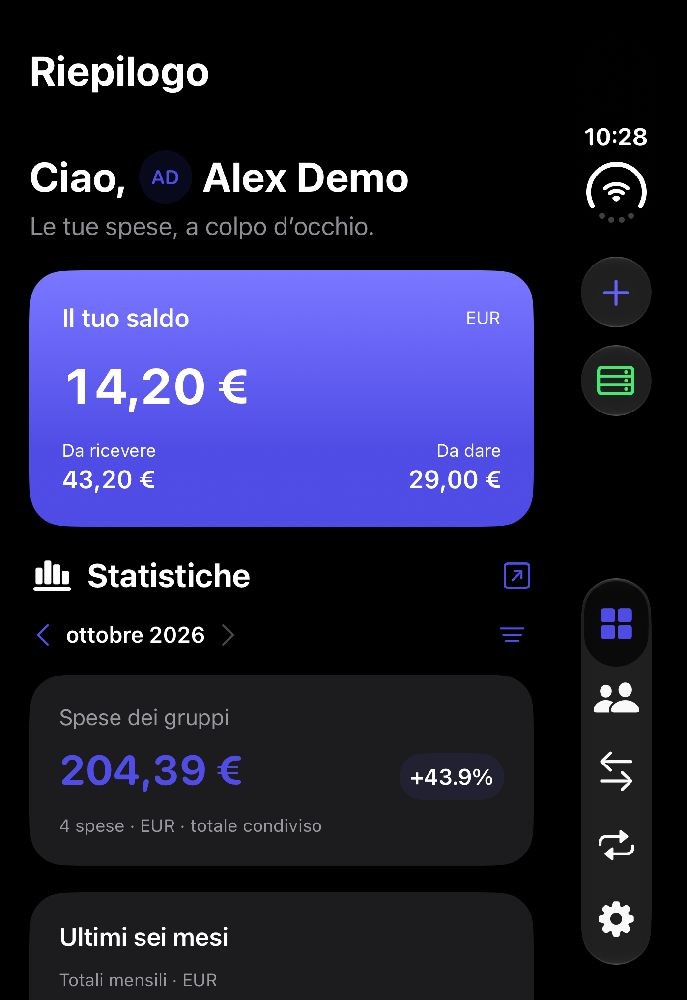
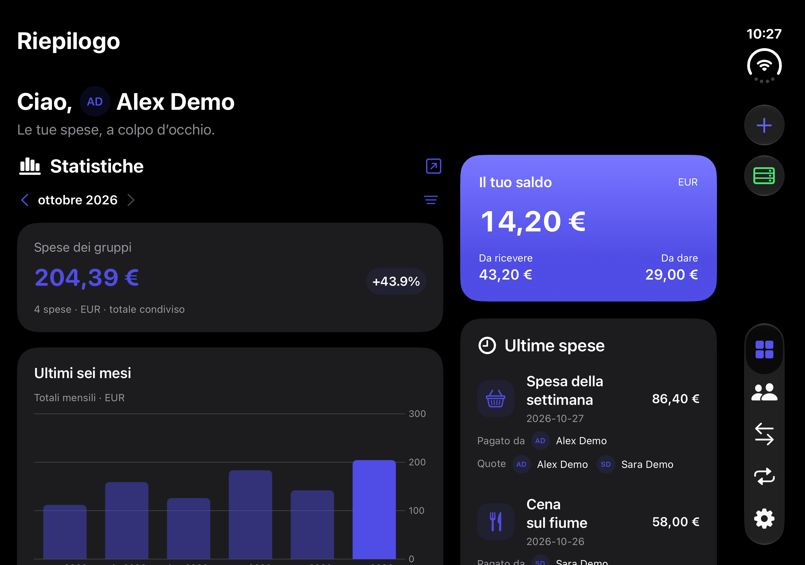

<p align="center"></p>

# Split Companion

[](https://github.com/andreaconfa/SplitCompanion/actions/workflows/validate.yml)
[](LICENSE)

**Shared expenses. Your server. Your data.**

Split bills, manage shared subscriptions and keep track of who owes what — from
your browser, an installable PWA or the native iOS companion. Built for households,
friends and small private groups, with a consistent interface across devices.

**[Installation guide](wiki/Installation.md)** · **[Documentation](wiki/Home.md)** · **[Roadmap](ROADMAP.md)** · **[Security](SECURITY.md)**

## One app, across your devices

### Web app

Open the web app directly in your browser. The spacious desktop layout brings
balances, monthly charts, recent activity and upcoming payments together.



### PWA

Add Split Companion to your phone's Home Screen for an app-like experience without
installing the native app. The responsive interface adapts to standard iPhones
and to iPhone Duo's closed and open screen sizes, based on the available width.
HTTPS is required for the full PWA experience. [PWA setup](docs/pwa.md).

<p align="center">
  
  
</p>

### Native iOS app — awaiting Apple review

The native SwiftUI companion connects to the same self-hosted backend as the web
app. App Store availability will be announced after Apple approval; there is no
public App Store download yet.

- Adaptive layouts for standard iPhones and **iPhone Duo**, closed or open.
- Multiple server profiles, shared expenses, subscriptions, credits and statistics.
- **Home Screen and Lock Screen widgets** for a quick look at your balances and upcoming payments.
- A **mini companion app for Apple Watch**, with balances, recent expenses and upcoming payments.
- **Watch face complications** for information at a glance.
- Server API compatibility checks with guidance when the app or server needs an update.

Widgets and Watch display the latest summary synced from the iPhone. They are not
independent server clients; fresh data requires an iPhone refresh and connectivity.

<p align="center"></p>



*Screenshots use fictional demo data and the Indigo accent. They show the current
Italian-language interface; the documentation is in English. Native screenshots
are development previews. Native iOS source is not included in this repository.*

## What you can do

- Split expenses equally, by exact amounts, by percentages or assign them to one person.
- Track balances and settlements separately for each currency, without automatic conversion.
- Manage recurring subscriptions, advance payments, credits and refunds.
- Explore monthly statistics, categories, participant avatars and transaction history.
- Import Splitwise CSV/JSON exports with preview and rollback.
- Use local accounts, two-factor authentication and complete backups.
- Choose light or dark appearance and five accent colors.

## Quick start on Linux

You need Docker Engine with the Compose plugin and a local disk on a Linux server
(amd64 / x86-64, Intel or AMD). Run **one replica and one worker**. Do not put SQLite on NFS or SMB.

1. Download `compose.yaml` and `env.example` from the [same release](https://github.com/andreaconfa/SplitCompanion/releases/tag/v1.2.0-rc.4).
2. Prepare the configuration and persistent directories:

   ```sh
   cp env.example .env
   sudo install -d -m 0700 -o 10001 -g 10001 data backups
   ```

3. The example selects `ghcr.io/andreaconfa/splitcompanion:1.2.0-rc.4`. You can pin
   the digest from the release instead.
   Alternatively, [build from source](docs/native.md).
4. Start the application and generate the initial setup code:

   ```sh
   docker compose pull
   docker compose up -d
   docker compose exec app python -m app.cli setup-token
   ```

5. Open `http://localhost:8000` on the server and create the administrator account.
   The code expires after 30 minutes and can only be used once. Complete two-factor
   authentication and store your recovery codes somewhere safe.

The default binding is **127.0.0.1**, accessible only on the server. To connect from
a trusted LAN, set `SPLIT_COMPANION_BIND` to the server's LAN address and recreate
the container. HTTP does not encrypt credentials or data. For Internet access or
a phone PWA, configure your own [external HTTPS reverse proxy](docs/proxy.md).

## Update the container, keep your data

| Host directory | Container path | Contents |
| --- | --- | --- |
| `./data` | `/data` | SQLite database, instance secret, push keys and operational state |
| `./backups` | `/backups` | Complete backup archives |

Choose different absolute host paths in `.env` if needed. Both directories must
exist and be writable by UID/GID `10001:10001`. Do not use `chmod 777`.
Recreating the container keeps these directories intact. Keep the entire `data`
directory, not just the `.db` file: losing the secret prevents MFA recovery.

```sh
docker compose exec app python -m app.cli backup-full --output-dir /backups --kind manual
# Set the new image version or digest in .env, then:
docker compose pull
docker compose up -d
docker compose ps
```

For archive-based installations, use `docker load` instead of `pull`.
Read the [backup and restore guide](docs/operations.md) before downgrading.

## A single application container

The container includes the backend and compiled web app. It serves HTTP on port
8000. **It does not include Caddy, Nginx, TLS certificates or HTTPS management.**
Choose and manage your own proxy, DNS, certificates and firewall.

There is no public sign-up: the administrator creates users for a private instance.
No managed cloud account is required. The [source is available](docs/native.md)
for experienced users who want to build or run the application natively on Linux.

## Documentation and next steps

- [Installation and configuration wiki](wiki/Home.md)
- [Build from source or run natively](docs/native.md)
- [External reverse proxy and HTTPS](docs/proxy.md)
- [Backup, updates and account recovery](docs/operations.md)
- [PWA and notifications](docs/pwa.md)
- [Internet exposure and security](SECURITY.md)
- [Client compatibility](docs/compatibility.md)
- [Roadmap: personal expenses, Android and more](ROADMAP.md)
- [Contributing](CONTRIBUTING.md)

## License

Server and web/PWA source are licensed under [GNU AGPL-3.0](LICENSE).
The native iOS app is distributed separately; its source is not included here.
Official container builds provide their corresponding source through the source
link in Settings and at `/api/source`. See [NOTICE](NOTICE) for third-party notices.
